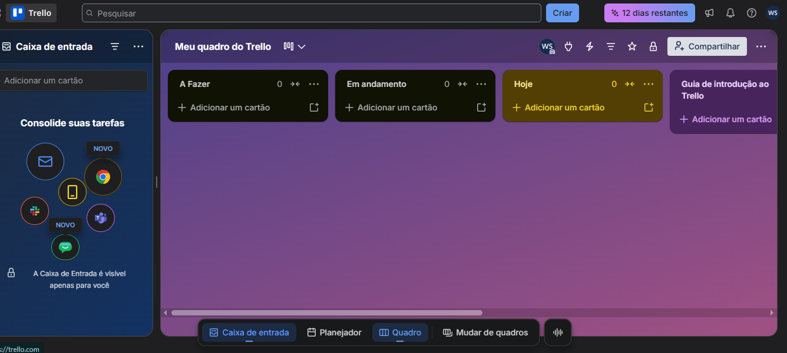

# 🤖 Agente de Produtividade com IA — Google ADK, Trello e Telegram

## 📌 Sobre o projeto

O **Agente de Produtividade** é uma aplicação desenvolvida em Python que utiliza inteligência artificial por meio do Google ADK e do Gemini para auxiliar no gerenciamento de tarefas.

O projeto integra a API do Trello para organizar atividades e a API do Telegram para enviar notificações sobre operações realizadas.

```bash
"""
Agente de Produtividade
Integra Google ADK/Gemini, Trello e Telegram.

Estrutura esperada:

Agente_de_Produtividade_com_IA_Google_ADK_Trello_Telegram/
│
├── .env
├── .gitignore
├── requirements.txt
│
└── agente_produtividade/
    ├── __init__.py
    └── agent.py

Execute a partir da raiz do projeto com:
    adk web app
ou conforme a forma de execução da sua instalação do Google ADK.
"""

from __future__ import annotations

import logging
import os
from datetime import date, datetime, time
from pathlib import Path
from typing import Any
from zoneinfo import ZoneInfo

import requests
from dotenv import load_dotenv
from trello import TrelloClient
from google.adk.agents import Agent


# ============================================================
# CONFIGURAÇÃO
# ============================================================

BASE_DIR = Path(__file__).resolve().parent.parent
ENV_FILE = BASE_DIR / ".env"

if not ENV_FILE.is_file():
    raise FileNotFoundError(
        f"Arquivo .env não encontrado em: {ENV_FILE}. "
        "Crie o arquivo na raiz do projeto."
    )

load_dotenv(dotenv_path=ENV_FILE, override=False)

TIMEZONE_NAME = os.getenv("APP_TIMEZONE", "America/Sao_Paulo")
DEFAULT_TRELLO_LIST = os.getenv("TRELLO_DEFAULT_LIST", "A Fazer")
GOOGLE_MODEL = os.getenv("GOOGLE_MODEL", "").strip()

try:
    APP_TIMEZONE = ZoneInfo(TIMEZONE_NAME)
except Exception as exc:
    raise RuntimeError(
        f"Fuso horário inválido em APP_TIMEZONE: {TIMEZONE_NAME}"
    ) from exc


# ============================================================
# LOGGING
# ============================================================

LOG_DIR = BASE_DIR / "logs"
LOG_DIR.mkdir(parents=True, exist_ok=True)

logging.basicConfig(
    level=os.getenv("LOG_LEVEL", "INFO").upper(),
    format="%(asctime)s | %(levelname)s | %(name)s | %(message)s",
    handlers=[
        logging.StreamHandler(),
        logging.FileHandler(LOG_DIR / "agente_produtividade.log", encoding="utf-8"),
    ],
)

logger = logging.getLogger("agente_produtividade")


# ============================================================
# VALIDAÇÃO DAS CONFIGURAÇÕES
# ============================================================

REQUIRED_ENV = (
    "GOOGLE_API_KEY",
    "TRELLO_API_KEY",
    "TRELLO_TOKEN",
    "TRELLO_BOARD_ID",
    "TELEGRAM_BOT_TOKEN",
    "TELEGRAM_CHAT_ID",
)

missing_vars = [name for name in REQUIRED_ENV if not os.getenv(name, "").strip()]

if missing_vars:
    raise RuntimeError(
        "Variáveis ausentes no arquivo .env: " + ", ".join(missing_vars)
    )

if not GOOGLE_MODEL:
    raise RuntimeError(
        "Defina GOOGLE_MODEL no .env com um identificador de modelo Gemini "
        "atualmente disponível para sua conta e versão do Google ADK."
    )

# O Google ADK normalmente lê GOOGLE_API_KEY diretamente do ambiente.
# Não registre nem imprima o conteúdo dessa chave.


# ============================================================
# CLIENTES E ACESSO AO TRELLO
# ============================================================

try:
    trello = TrelloClient(
        api_key=os.environ["TRELLO_API_KEY"],
        token=os.environ["TRELLO_TOKEN"],
    )
    board = trello.get_board(os.environ["TRELLO_BOARD_ID"])
except Exception as exc:
    logger.exception("Não foi possível inicializar a conexão com o Trello.")
    raise RuntimeError(
        "Falha ao conectar ao Trello. Verifique TRELLO_API_KEY, "
        "TRELLO_TOKEN e TRELLO_BOARD_ID."
    ) from exc


def _normalizar_texto(valor: str, campo: str, limite: int) -> str:
    """Valida e normaliza um campo textual."""
    if not isinstance(valor, str):
        raise ValueError(f"O campo '{campo}' deve ser um texto.")

    valor = valor.strip()

    if not valor:
        raise ValueError(f"O campo '{campo}' não pode ficar vazio.")

    if len(valor) > limite:
        raise ValueError(
            f"O campo '{campo}' excede o limite de {limite} caracteres."
        )

    return valor


def _get_list_by_name(nome_lista: str):
    """Localiza uma lista do quadro pelo nome, sem diferenciar maiúsculas."""
    nome = _normalizar_texto(nome_lista, "nome_lista", 200).casefold()

    for lista in board.all_lists():
        if lista.name.strip().casefold() == nome:
            return lista

    return None


def _parse_data_vencimento(data_vencimento: str) -> datetime | None:
    """
    Converte YYYY-MM-DD para o final daquele dia no fuso configurado.
    A validação ocorre antes de qualquer criação/movimentação no Trello.
    """
    if data_vencimento is None:
        return None

    if not isinstance(data_vencimento, str):
        raise ValueError("A data de vencimento deve ser um texto YYYY-MM-DD.")

    data_vencimento = data_vencimento.strip()
    if not data_vencimento:
        return None

    try:
        data = date.fromisoformat(data_vencimento)
    except ValueError as exc:
        raise ValueError(
            "Data inválida. Informe uma data real no formato YYYY-MM-DD."
        ) from exc

    return datetime.combine(
        data,
        time(hour=23, minute=59, second=0),
        tzinfo=APP_TIMEZONE,
    )


def _enviar_telegram(mensagem: str) -> dict[str, Any]:
    """Envia uma notificação pelo Telegram sem expor o token nos logs."""
    token = os.environ["TELEGRAM_BOT_TOKEN"]
    chat_id = os.environ["TELEGRAM_CHAT_ID"]
    url = f"https://api.telegram.org/bot{token}/sendMessage"

    try:
        response = requests.post(
            url,
            json={
                "chat_id": chat_id,
                "text": mensagem,
            },
            timeout=(5, 15),
        )
        response.raise_for_status()

        try:
            resultado = response.json()
        except requests.exceptions.JSONDecodeError:
            logger.error("Telegram retornou uma resposta que não é JSON.")
            return {
                "sucesso": False,
                "erro": "Resposta inválida recebida do Telegram.",
            }

        if not resultado.get("ok"):
            descricao = resultado.get("description", "Erro não especificado.")
            logger.warning("Telegram recusou a notificação: %s", descricao)
            return {"sucesso": False, "erro": descricao}

        return {"sucesso": True, "mensagem": "Notificação enviada."}

    except requests.Timeout:
        logger.warning("Tempo limite excedido ao enviar mensagem ao Telegram.")
        return {"sucesso": False, "erro": "Tempo limite excedido no Telegram."}
    except requests.RequestException as exc:
        logger.warning("Falha de comunicação com o Telegram: %s", exc)
        return {
            "sucesso": False,
            "erro": "Não foi possível enviar a notificação ao Telegram.",
        }


def _resultado_erro(mensagem: str, exc: Exception | None = None) -> dict[str, Any]:
    """Monta respostas de erro sem devolver detalhes internos ao agente."""
    if exc is not None:
        logger.exception("%s", mensagem, exc_info=exc)
    return {"sucesso": False, "mensagem": mensagem}


# ============================================================
# FERRAMENTA: CRIAR TAREFA
# ============================================================

def criar_card_trello(
    nome_tarefa: str,
    descricao: str = "",
    data_vencimento: str = "",
) -> dict[str, Any]:
    """
    Cria uma tarefa na lista padrão do Trello e tenta notificar pelo Telegram.

    Args:
        nome_tarefa: Título da tarefa.
        descricao: Descrição opcional.
        data_vencimento: Data opcional no formato YYYY-MM-DD.
    """
    try:
        nome = _normalizar_texto(nome_tarefa, "nome_tarefa", 200)

        if not isinstance(descricao, str):
            raise ValueError("A descrição deve ser um texto.")
        descricao = descricao.strip()
        if len(descricao) > 10000:
            raise ValueError("A descrição excede 10.000 caracteres.")

        vencimento = _parse_data_vencimento(data_vencimento)

        lista = _get_list_by_name(DEFAULT_TRELLO_LIST)
        if lista is None:
            return {
                "sucesso": False,
                "mensagem": (
                    f"A lista '{DEFAULT_TRELLO_LIST}' não foi encontrada "
                    "no quadro Trello."
                ),
            }

        card = lista.add_card(name=nome, desc=descricao)

        if vencimento is not None:
            try:
                card.set_due(vencimento)
            except Exception:
                # O card já existe; comunicar explicitamente o estado parcial.
                logger.exception(
                    "Card %s criado, mas houve falha ao configurar vencimento.",
                    card.id,
                )
                return {
                    "sucesso": False,
                    "criado": True,
                    "card_id": card.id,
                    "mensagem": (
                        "A tarefa foi criada, mas não foi possível configurar "
                        "a data de vencimento. Verifique o card no Trello."
                    ),
                }

        data_formatada = (
            vencimento.strftime("%d/%m/%Y") if vencimento else "Não definido"
        )

        mensagem = (
            "📌 Nova tarefa criada no Trello!\n\n"
            f"📋 Tarefa: {nome}\n"
            f"📝 Descrição: {descricao or 'Não informada'}\n"
            f"📅 Vencimento: {data_formatada}"
        )
        notificacao = _enviar_telegram(mensagem)

        return {
            "sucesso": True,
            "mensagem": "Tarefa criada no Trello.",
            "card_id": card.id,
            "nome": nome,
            "lista": lista.name,
            "vencimento": data_formatada,
            "notificacao_telegram": notificacao,
        }

    except ValueError as exc:
        return {"sucesso": False, "mensagem": str(exc)}
    except Exception:
        logger.exception("Erro inesperado ao criar tarefa no Trello.")
        return {
            "sucesso": False,
            "mensagem": "Não foi possível criar a tarefa no Trello.",
        }


# ============================================================
# FERRAMENTA: LISTAR TAREFAS
# ============================================================

def listar_tarefas() -> dict[str, Any]:
    """Lista os cards abertos do quadro Trello, incluindo lista e vencimento."""
    try:
        cards = board.open_cards()
        tarefas = []

        for card in cards:
            vencimento = card.due
            if vencimento:
                vencimento = str(vencimento)

            tarefas.append(
                {
                    "id": card.id,
                    "nome": card.name,
                    "lista": card.list_name,
                    "vencimento": vencimento,
                    "url": getattr(card, "url", None),
                }
            )

        return {
            "sucesso": True,
            "total": len(tarefas),
            "tarefas": tarefas,
        }

    except Exception:
        logger.exception("Erro ao listar tarefas do Trello.")
        return {
            "sucesso": False,
            "mensagem": "Não foi possível listar as tarefas do Trello.",
        }


# ============================================================
# FERRAMENTA: MOVER TAREFA
# ============================================================

def mover_card(
    identificador: str,
    lista_destino: str,
) -> dict[str, Any]:
    """
    Move um card para outra lista do Trello.

    Args:
        identificador: ID do card ou nome exato da tarefa.
        lista_destino: Nome da lista de destino.
    """
    try:
        identificador = _normalizar_texto(
            identificador, "identificador", 200
        )
        lista_destino = _normalizar_texto(
            lista_destino, "lista_destino", 200
        )

        cards = board.open_cards()

        # Prioriza correspondência exata pelo ID.
        card = next((item for item in cards if item.id == identificador), None)

        if card is None:
            encontrados = [
                item
                for item in cards
                if item.name.strip().casefold() == identificador.casefold()
            ]

            if not encontrados:
                return {
                    "sucesso": False,
                    "mensagem": "Tarefa não encontrada entre os cards abertos.",
                }

            if len(encontrados) > 1:
                return {
                    "sucesso": False,
                    "mensagem": (
                        "Há várias tarefas com esse nome. Informe o ID "
                        "do card para evitar mover a tarefa errada."
                    ),
                    "cards_encontrados": [
                        {"id": item.id, "nome": item.name}
                        for item in encontrados
                    ],
                }

            card = encontrados[0]

        destino = _get_list_by_name(lista_destino)
        if destino is None:
            return {
                "sucesso": False,
                "mensagem": f"A lista de destino '{lista_destino}' não existe.",
            }

        if getattr(card, "list_id", None) == destino.id:
            return {
                "sucesso": True,
                "mensagem": "A tarefa já está na lista solicitada.",
                "card_id": card.id,
                "lista_destino": destino.name,
            }

        card.change_list(destino.id)

        # Recarrega os dados para confirmar a alteração no Trello.
        card_atualizado = trello.get_card(card.id)
        lista_confirmada = getattr(card_atualizado, "list_name", None)

        mensagem = (
            "🔄 Tarefa movimentada no Trello!\n\n"
            f"📋 Tarefa: {card.name}\n"
            f"📍 Nova lista: {destino.name}"
        )
        notificacao = _enviar_telegram(mensagem)

        return {
            "sucesso": True,
            "mensagem": "Solicitação de movimentação concluída.",
            "card_id": card.id,
            "lista_destino": lista_confirmada or destino.name,
            "notificacao_telegram": notificacao,
        }

    except ValueError as exc:
        return {"sucesso": False, "mensagem": str(exc)}
    except Exception:
        logger.exception("Erro ao mover tarefa no Trello.")
        return {
            "sucesso": False,
            "mensagem": "Não foi possível mover a tarefa no Trello.",
        }


# ============================================================
# AGENTE GOOGLE ADK
# ============================================================

root_agent = Agent(
    name="agente_produtividade",
    model=GOOGLE_MODEL,
    description=(
        "Assistente de produtividade integrado ao Trello e Telegram. "
        "Cria, consulta e movimenta tarefas."
    ),
    instruction="""
Você é um assistente pessoal de produtividade integrado ao Trello.

FERRAMENTAS DISPONÍVEIS:
1. criar_card_trello: cria uma tarefa na lista padrão configurada.
2. listar_tarefas: consulta os cards abertos do quadro.
3. mover_card: move uma tarefa para outra lista.

REGRAS OBRIGATÓRIAS:
- Use as ferramentas para consultar ou alterar dados do Trello.
- Nunca diga que uma tarefa foi criada ou movida sem retorno de sucesso
  da ferramenta.
- Diferencie falha total de operação parcial. Por exemplo, a tarefa pode
  ter sido criada mesmo que a configuração do vencimento tenha falhado.
- Não invente IDs, nomes de listas, datas ou informações de tarefas.
- Antes de criar uma tarefa, obtenha o título. A descrição e a data são
  opcionais; não invente esses dados.
- A data deve ser enviada no formato YYYY-MM-DD. Se o usuário disser
  "amanhã" ou outra data relativa, determine a data somente se o contexto
  de data atual estiver disponível; caso contrário, peça esclarecimento.
- Para mover uma tarefa, obtenha o identificador e a lista de destino.
- Se houver tarefas com nomes duplicados, peça o ID do card.
- Não exclua tarefas: não existe ferramenta de exclusão disponível.
- Informe quando a notificação do Telegram falhar, sem afirmar que a
  operação principal falhou se o Trello confirmou a alteração.
- Responda em português, com clareza e objetividade.
""",
    tools=[
        criar_card_trello,
        listar_tarefas,
        mover_card,
    ],
)

```

A proposta é facilitar a organização pessoal e profissional, permitindo que o usuário gerencie tarefas por meio de comandos em linguagem natural.

## 🎯 Objetivos

- Automatizar a criação de tarefas.
- Consultar tarefas cadastradas no Trello.
- Movimentar cartões entre listas.
- Enviar notificações pelo Telegram.
- Integrar inteligência artificial a ferramentas de produtividade.
- Praticar desenvolvimento Python e integração com APIs.

## ⚙️ Tecnologias utilizadas

| Tecnologia | Finalidade |
|---|---|
| Python | Linguagem principal |
| Google ADK | Framework para desenvolvimento de agentes de IA |
| Google Gemini | Modelo de inteligência artificial |
| Trello API | Gerenciamento de tarefas e cartões |
| Telegram Bot API | Envio de notificações |
| Requests | Comunicação HTTP |
| Python-dotenv | Gerenciamento de variáveis de ambiente |
| Logging | Registro de eventos e erros |

## ✨ Funcionalidades

### 1. Criar tarefas no Trello

A ferramenta `criar_card_trello` permite criar cartões na lista **A Fazer**, incluindo:

- Nome da tarefa.
- Descrição.
- Data de vencimento opcional.

Lista **A Fazer**


Após a criação, o sistema tenta enviar uma notificação pelo Telegram.

### 2. Listar tarefas

A ferramenta `listar_tarefas` consulta os cartões abertos do quadro Trello e retorna informações como:

- Identificador do cartão.
- Nome da tarefa.
- Lista em que está localizada.
- Data de vencimento, quando disponível.

### 3. Mover tarefas entre listas

A ferramenta `mover_card` permite transferir um cartão para outra lista do quadro.

A tarefa pode ser identificada pelo ID ou pelo nome exato. Quando existem tarefas com nomes duplicados, o sistema solicita o identificador para evitar ambiguidades.

### 4. Notificações pelo Telegram

A função `_enviar_telegram` envia mensagens por meio da API oficial do Telegram.

As notificações incluem informações sobre tarefas criadas ou movimentadas. Falhas de comunicação são tratadas pela aplicação.

### 5. Configuração por variáveis de ambiente

As credenciais e configurações são carregadas de um arquivo `.env`, evitando a necessidade de inserir chaves de API diretamente no código-fonte.

### 6. Registro de eventos

O módulo `logging` registra informações e erros que ajudam na identificação de problemas durante a execução.

## 🏗️ Arquitetura do projeto

```text
Agente_de_Produtividade_com_IA_Google_ADK_Trello_Telegram/
│
├── .env
├── .gitignore
├── requirements.txt
│
└── agente_produtividade/
    ├── __init__.py
    └── agent.py
```

### Descrição dos arquivos

| Arquivo | Descrição |
|---|---|
| `.env` | Armazena as configurações e credenciais locais |
| `.gitignore` | Define arquivos e pastas que não devem ser enviados ao Git |
| `requirements.txt` | Lista as dependências Python |
| `__init__.py` | Inicializa o pacote do agente |
| `agent.py` | Contém a configuração do agente, as ferramentas e as integrações |

## 📋 Pré-requisitos

Antes de executar o projeto, você precisará de:

- Python instalado.
- Uma chave de API do Google AI.
- Uma conta Trello com acesso ao quadro desejado.
- Uma chave de API e um token de acesso do Trello.
- Um bot do Telegram e o respectivo ID do chat.
- Acesso à internet para comunicação com as APIs.

## 🚀 Instalação

### 1. Clonar o repositório

```bash
git https://github.com/wandreson-silva/Agente_de_Produtividade_com_IA_Google_ADK_Trello_Telegram
cd Agente_de_Produtividade_com_IA_Google_ADK_Trello_Telegram
```

Substitua o endereço acima pelo endereço real do seu repositório.

### 2. Criar um ambiente virtual

No Windows PowerShell:

```powershell
python -m venv .venv
```

Ative o ambiente:

```powershell
.\.venv\Scripts\Activate
```

### 3. Instalar as dependências

```powershell
python -m pip install --upgrade pip
python -m pip install google-adk py-trello requests python-dotenv
```

### 4. Configurar as variáveis de ambiente

Crie um arquivo `.env` na raiz do projeto:

```env
# Google Gemini
GOOGLE_API_KEY=SUA_CHAVE_GOOGLE
GOOGLE_MODEL=MODELO_GEMINI_DISPONIVEL

# Trello
TRELLO_API_KEY=SUA_CHAVE_TRELLO
TRELLO_TOKEN=SEU_TOKEN_TRELLO
TRELLO_BOARD_ID=ID_DO_QUADRO

# Telegram
TELEGRAM_BOT_TOKEN=TOKEN_DO_BOT
TELEGRAM_CHAT_ID=ID_DO_CHAT
```

Utilize credenciais válidas e substitua os valores de exemplo. O nome do modelo deve corresponder a um modelo disponível para sua conta e compatível com a versão instalada do Google ADK.

## ▶️ Executar o agente

Na raiz do projeto, com o ambiente virtual ativado:

```powershell
adk run agente_produtividade
```

Para iniciar a interface web de desenvolvimento do Google ADK:

```powershell
adk web --port 8000
```

Siga as instruções exibidas no terminal para acessar a interface.

## 🧪 Exemplos de utilização

Os exemplos abaixo ilustram solicitações que o agente pode interpretar, desde que as integrações estejam configuradas corretamente.

**Criar tarefa:**

```text
Crie uma tarefa chamada "Revisar projeto elétrico",
com descrição "Verificar os diagramas e circuitos"
e vencimento em 2026-12-15.
```

**Listar tarefas:**

```text
Liste as tarefas abertas do meu quadro Trello.
```

**Mover tarefa:**

```text
Mova a tarefa "Revisar projeto elétrico"
para a lista "Em andamento".
```

Os nomes das listas precisam corresponder às listas existentes no quadro Trello.

## 🔐 Segurança

Para proteger credenciais e informações de acesso:

- Nunca publique o arquivo `.env`.
- Não insira tokens ou chaves de API diretamente no código.
- Utilize um arquivo `.gitignore`.
- Não compartilhe logs que possam conter informações confidenciais.
- Restrinja o acesso às credenciais do Trello e do Telegram.
- Revogue e substitua imediatamente qualquer credencial exposta.
- Utilize apenas quadros e contas para os quais tenha autorização.

Exemplo de `.gitignore`:

```gitignore
.env
.venv/
__pycache__/
*.py[cod]
*.log
logs/
```

Se credenciais reais já tiverem sido publicadas, removê-las do arquivo não é suficiente: elas devem ser revogadas ou rotacionadas no serviço correspondente.

## ⚠️ Limitações conhecidas

- A criação de tarefas utiliza a lista configurada como `A Fazer`.
- A listagem considera cartões abertos do quadro.
- A movimentação depende da existência da lista de destino.
- As notificações dependem da disponibilidade da API do Telegram.
- O envio de uma notificação pode falhar mesmo quando a operação no Trello foi concluída.
- O projeto depende de credenciais válidas, conectividade e compatibilidade entre as dependências instaladas.
- O script original não implementa exclusão de tarefas, autenticação de usuários na aplicação ou persistência local adicional.

## 🔧 Possíveis melhorias futuras

- Adicionar prioridades e etiquetas às tarefas.
- Implementar edição de cartões e atualização de vencimentos.
- Criar lembretes automáticos.
- Implementar relatórios diários e semanais.
- Adicionar testes automatizados com `pytest`.
- Implementar validação mais rigorosa dos dados de entrada.
- Criar uma interface web com FastAPI.
- Adicionar persistência complementar com SQLite.
- Implementar monitoramento e histórico de operações.
- Adicionar controle de acesso e mecanismos contra operações duplicadas.

## 📚 Aprendizados

Este projeto permite explorar conceitos importantes de desenvolvimento e automação:

- Desenvolvimento de agentes de inteligência artificial.
- Integração de APIs REST.
- Programação em Python.
- Gerenciamento de variáveis de ambiente.
- Automação de tarefas.
- Tratamento de exceções.
- Registro de eventos e diagnóstico de erros.
- Integração entre serviços digitais.

## 👨‍💻 Autor

**Wandreson Silva**

Engenharia Elétrica | Automação | Tecnologia | Python | Inteligência Artificial | Cibersegurança


---

⭐ Se este projeto for útil para seus estudos, acompanhe sua evolução e contribua com sugestões de melhorias.

